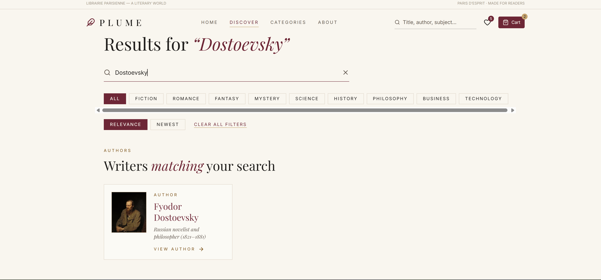
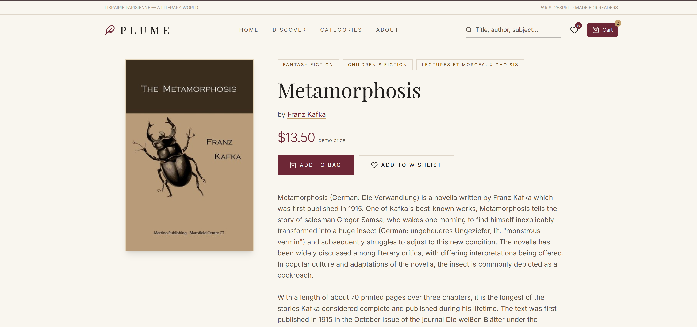
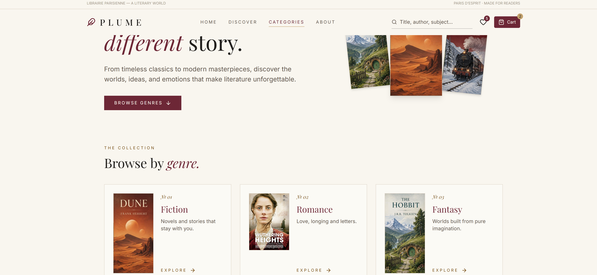
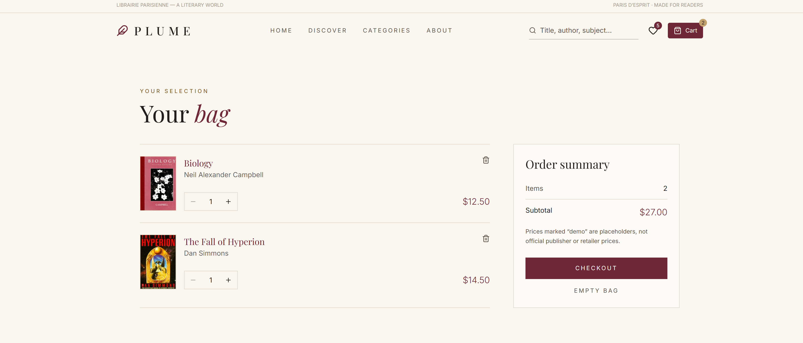

# PLUME

PLUME is a French-themed literary library for discovering books and authors, built as a frontend-only graduation project at ITI. There is no backend: all data comes from public APIs, and the wishlist and cart live in the browser.

## Screenshots

| Home | Discover |
| --- | --- |
|  |  |

| Book details | Categories |
| --- | --- |
|  |  |

| Cart |
| --- |
|  |

## Features

- Home page with a curated literary landing section.
- Discover page to search books by title or author, with an Authors section above the book results.
- Categories page to browse books by subject.
- Book details page for each book.
- Author pages with a biography summary from Wikipedia and a list of the author's books.
- Wishlist and cart, saved in the browser with `localStorage`.
- About page and a custom 404 page.

## Demo notice

PLUME is not a real store.

- Prices are demo prices generated deterministically in the app. They are not real prices.
- Checkout is a demo. It does not place orders or take payment.
- The newsletter form is a demo. It does not send or store any email.

## Tech stack

- React and Vite
- React Router
- Tailwind CSS v4
- Iconify (`@iconify/react`) with Lucide icons
- Native `fetch`, React Context, and `localStorage`

## Getting started

Requirements: Node.js and npm.

```bash
git clone https://github.com/Elwasify/PLUME.git
cd PLUME
npm install
npm run dev
```

Vite prints the local address in the terminal. Open it in your browser.

Other commands:

```bash
npm run build
npm run preview
npm run lint
```

## API keys

No API keys are required. The project reads no environment variables, so there is no `.env` file to create.

## Data sources

- Books: [Open Library](https://openlibrary.org/), through its public API with no key. Results and cover availability depend on the Open Library catalog.
- Authors: [Wikipedia](https://www.wikipedia.org/) summary and search APIs. Wikipedia text is available under [CC BY-SA](https://creativecommons.org/licenses/by-sa/4.0/).

## Image credits

- Kafka portrait on the About page: [Franz Kafka, 1923](https://commons.wikimedia.org/wiki/File:Franz_Kafka,_1923.jpg) on Wikimedia Commons, public domain.
- Book covers are loaded from Open Library.

## Deployment

The project includes a `vercel.json` with a single-page-app rewrite so that refreshing or opening an inner route directly loads the app.

## Known limitations

- The author page matches books by exact normalized author name, so authors whose names are stored with alternate spellings in Open Library may show fewer books.